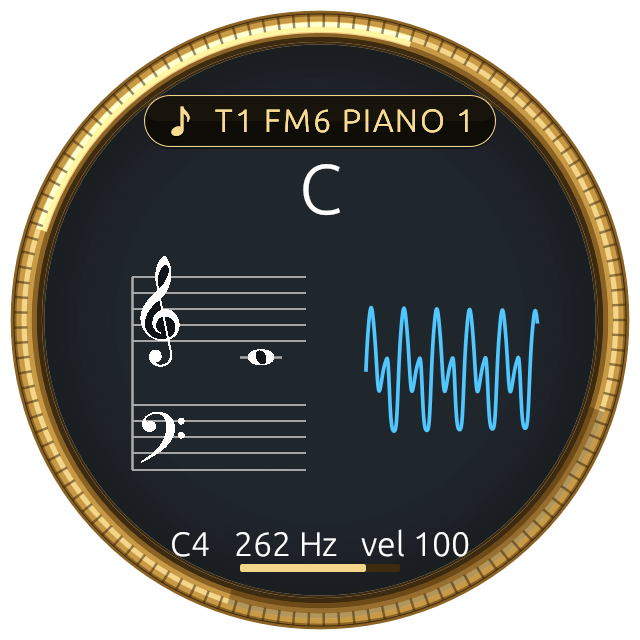

# MIDI Spyglass

**Standalone: no FM-1 required.** Any MIDI keyboard, controller or music app will do.

The spyglass from [FM-1 Mirror](https://github.com/pfkellogg/fm1-mirror), on its own, for any MIDI keyboard or
app. A round brass eyepiece floats over everything and shows what you play:

- the **note** or **chord** name (C major, Cmaj7, …), big
- the notes on a **grand staff**
- a **waveform** beside the staff: the synth's real sound, standing still like an oscilloscope's (the FM-1's USB
  audio by itself, or any audio input from the menu), else drawn from the notes you hold
- the full name, the pitch in Hz, and **how hard** the key was hit
- the **sound**, across the top, following what the keyboard plays: on an FM-1 with Big Screen firmware, the sound
  it's playing (*T1 FM6 PIANO 1*); a soft synth's name (*Analog Lab V*); both when they're layered; else the General
  MIDI name of the last Program Change (for example *Electric Piano 1 · 5*)

It finds every MIDI device the computer or tablet has, and picks up a keyboard the moment it's plugged in. It sends
MIDI only to the synths you tick under TO, and a hello once a second to an FM-1, which makes the FM-1's Big Screen
firmware say the name of its sound.

## Download

Mac, Windows, Linux and Android: see [Releases](../../releases).

| | |
| --- | --- |
| **Mac** | `MIDI-Spyglass-mac.zip`: unzip, drag *MIDI Spyglass* to Applications. The first time, right-click it and choose Open. |
| **Windows** | `MIDI-Spyglass-windows.exe`: run it (Windows may ask you to confirm an app from the internet). |
| **Linux** | `MIDI-Spyglass-linux`: `chmod +x` it and run it (needs ALSA). |
| **Android** | `MIDI-Spyglass-android.apk`: install it (Android 11 or newer, with MIDI). |

## Using it

**Click the glass** (on Android: tap it, then **≡**) for its **MIDI connections**, in pairs, like Synth Spyglass's
FROM and TO:

- **FROM**: tick a keyboard to make it a pair. Under it, **TO**: tick the synths it plays. Tick two and they play
  together (layered). An FM-1 gets its notes on channel 1, where it listens; nothing goes back to the port it came
  from.
- **Several pairs play at once**: one keyboard on the FM-1, another on Analog Lab V. The spyglass shows one pair at a
  time: the **⇄ switch on the dial** shows the next, and the header says whose ("Keystation 49 MK3 · T1 FM6 PIANO 1").
- **Soft synths** (Mac): Analog Lab V and the other Arturia apps, Splice INSTRUMENT, Pianoteq… are listed under TO by
  name. A soft synth plays what comes down the bus it listens to (IAC Driver Bus 1), so ticking it ticks that bus and
  opens the app.

**Mac, Windows, Linux:** drag the spyglass to move it; resize it with the brass grip on its rim (bottom right), or
scroll over it. **Right-click** it for *Sound name*, *Waveform*, *Waveform from*, *Always on top*, and *Quit*.

**Android:** drag it to move it, pinch it to resize it, tap it for the grip and ≡ (the connections, the waveform and
the sound name on or off). USB keyboards work straight away; a Bluetooth MIDI keyboard once it's paired in Android's
settings. Android lets one app at a time send to a device: with FM-1 Mirror + Spyglass open too, only one of them can
play the FM-1.

Where it is and its size are remembered. With nothing to listen to, it says **No MIDI found** and what to do.

**With an M-VAVE FM-1** (optional): its sound's name shows on top when it runs a Big Screen firmware
(*T1 FM6 PIANO 1*), and the waveform is its real sound from its USB audio.

## About the sound name and the waveform

MIDI carries notes, not sound. So:
- The **sound name** comes from Program Change messages. Its General MIDI name is right for General MIDI
  synths and apps; other synths number their sounds their own way, so the number after the name is the one to
  trust there.
- The **waveform** is your synth's real sound when the spyglass can hear it: the FM-1's own USB audio (picked by
  itself; *Waveform from* in the menu picks another audio input), and on a Mac (macOS 14.2 or later) the soft synths
  ticked under TO, through a small helper from Synth Spyglass that listens to just those apps. Layered, it shows the
  louder. On a Mac, allow the microphone once (any audio input counts as one), and recording other apps' audio for
  the soft synths. Otherwise it's drawn from the notes: a sine at each held note's pitch and loudness, added up.

## Building

- Desktop (Rust): `cd desktop && cargo run --release`. On a Mac, `./make_app.sh` builds *MIDI Spyglass.app*
  (Apple silicon and Intel) and installs it in /Applications. Linux needs `libasound2-dev`.
- Android: `cd android && ./gradlew assembleRelease` (JDK 17).
- `tools/make_icon.py` draws the icon (Pillow).

## License

GPL-3.0, like FM-1 Mirror, which the spyglass comes from (it follows Synth Spyglass's look).
Contact: pfkellogg@gmail.com
